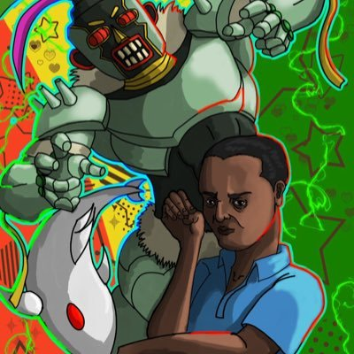

# Duany'ay — SillyTavern Character Card

Duany'ay, also spelled Duanyay and Duan'yay (@DuanyayEnasche; credited on IMDb as Duan'yay Edwards): comedian, actor and Fishtank Live's longest-staying freeloader, guest on episode 13 of The Crypto Craic Podcast, the official Bitcoin Obama podcast.

**Duany'ay** — official **SillyTavern character card** (Character Card V2, with the PNG card also embedding V3) for chatting with Duany'ay in SillyTavern — it also imports into Chub AI, Janitor AI, Agnai, RisuAI and Backyard AI.

## Files

- `duanyay.sillytavern.card.json` — the character card in JSON form.
- `card.png` — the PNG character card (same card, image form) where included.

## Use it

SillyTavern: Characters → Import Character → choose the card JSON or PNG.

## Duany'ay links

- On X: [@DuanyayEnasche](https://x.com/DuanyayEnasche)
- Wiki page: https://bitcoinobama.com/duanyay
- ElizaOS character file: https://github.com/cryptoiscrack/duanyay-elizaos-character

Free to use; credit bitcoinobama.com.
